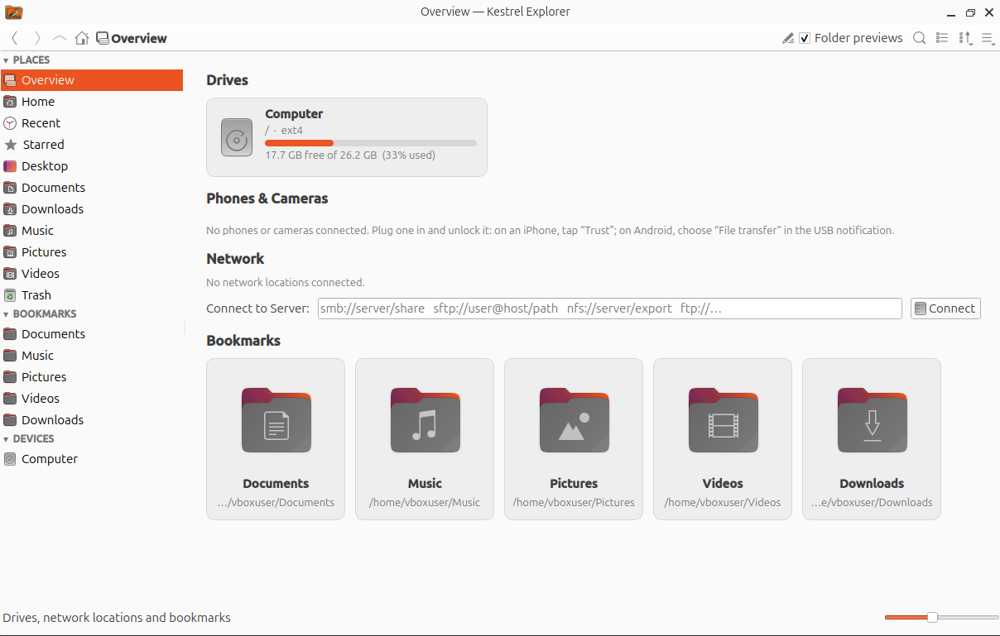

# Kestrel Explorer (C++)

**Version 0.3.1-alpha.9.** This is an early alpha release, so expect rough edges.

> **Why do Linux users still need five separate utilities and a terminal to do normal filesystem work?**

That's the question Kestrel sets out to answer, and why I'm building it.

A file manager for Ubuntu and Linux Mint that's easy to pick up and puts many jobs you'd normally do in a terminal into the window. It also adds quality-of-life improvements over GNOME Files. It's written in C++ with Qt 6.



**Terminal jobs, in the window:**
- **Archives:** create and extract 7z, zip, rar, zpaq and every tar format, with the options the command-line tools offer (level, method, threads, passwords, split volumes), and a preview of the exact command that will run. Double-click an archive to extract it.
- **Admin rights only when needed:** when an everyday file operation fails with "permission denied", choose **Retry as Administrator** and enter your password once per session, instead of running a file manager as root. It's for simple copies, moves, renames and deletes, not a replacement for the terminal for system administration.
- **Permissions and links:** permissions, including setuid, setgid and the sticky bit; symbolic, relative and hard links; and MD5/SHA checksums with verification. Double-click a checksum file (`.sfv`, `.md5`, `.sha256`, `SHA256SUMS`…) to check every file it lists. Right-click files or folders and choose **Create Checksum File…** to make one.
- **Metadata:** view and edit EXIF, XMP and other metadata with `exiftool`, from a searchable list of tags.
- **Search and rename:** search subfolders with wildcards or inside files, and batch rename with templates or regular expressions.
- **Shortcuts out:** Open in Terminal or VS Code, your Nautilus scripts, and Samba network sharing.
- **Secure deletion:** with [BleachBit](https://www.bleachbit.org) installed, shred files and folders or empty the trash so they can't be recovered, from the right-click menu; `kes-setup --bleachbit` also adds a cleaner for Kestrel's own cache and history to BleachBit.

**Improvements over GNOME Files:**
- Undo for moves, renames, Move to Trash and new files.
- One Trash for every drive, and an Overview page of drives with usage bars.
- Folder icons that preview the images inside, plus per-folder colours.
- A built-in image viewer, and GIF/WebM playback in the file view.
- Background copies with progress and Cancel in the status bar.
- Phones and cameras (iPhone, Android, PTP cameras) on the Overview page and in the sidebar, with thumbnails from the phone's own previews.
- A sidebar you can rearrange and collapse.
- A sort for each folder, and grouping by date (Today, Last week… or one group per day), by the date modified, created
  or taken (from photos' and videos' metadata), with each group still sorted by name, size or type.
- Follows the desktop's theme and accent colour, also when you change them while it's open.
- Other apps' Open and Save dialogs, such as a browser's "Save image as", can open in Kestrel.
- Several windows that stay in sync.
- Faster in most measurements (see [Performance: Kestrel vs GNOME Files](docs/performance.md#performance-kestrel-vs-gnome-files)).

**Improvements over Nemo** (Linux Mint's file manager):
- Archives created and extracted with every option in the window, instead of handing off to a separate archive app.
- Admin rights for just the operation that needs them, instead of opening a whole Nemo window as root.
- Folder icons that preview the images inside.
- A built-in image viewer, and GIF/WebM playback in the file view.
- Metadata viewing and editing (EXIF, XMP, and the prompts image generators such as Stable Diffusion save in the file) and checksums in Properties.
- Phones: thumbnails from the phone's own previews, and iPhone videos copied once so they play smoothly.
- Faster file operations in the benchmark: copying about 20× faster, moving to another drive 5.4× faster, and emptying the trash several hundred times faster (see [Performance: Kestrel vs Nemo](docs/performance.md#performance-kestrel-vs-nemo)).

**Installs alongside GNOME Files:** Kestrel installs next to GNOME Files (or Nemo on Linux Mint) instead of replacing it. The two share bookmarks, thumbnails, the clipboard, the trash and Recent files, so you can use either. `./install.sh --default` (or `kes-setup --default` with the apt package) makes Kestrel open folders and "Show in folder" requests and show other apps' Open/Save dialogs, and `./install.sh --uninstall` (`kes-setup --undo`) hands them back.

This began as a C++ port of the Python/PyQt6 [Kestrel Explorer](https://github.com/RegulusArms/kestrel-explorer). The two were the same up to 0.3.1-alpha.2; since then each is developed on its own. They still use the same settings folder, bookmarks and caches, but aren't kept compatible any more.

## Install

**With apt** (Ubuntu 24.04, Linux Mint 22 and newer, amd64), from the releases channel:

```bash
sudo install -d -m 755 /etc/apt/keyrings
sudo curl -fsSLo /etc/apt/keyrings/kestrel.asc https://regulusarms.github.io/kes-c/kestrel.asc
printf 'Types: deb\nURIs: https://regulusarms.github.io/kes-c\nSuites: stable\nComponents: main\nSigned-By: /etc/apt/keyrings/kestrel.asc\n' \
  | sudo tee /etc/apt/sources.list.d/kestrel.sources
sudo apt update && sudo apt install kestrel-explorer
kes-setup --default   # optional: make it your file manager (kes-setup --undo puts things back)
```

**From source:**

```bash
./install.sh             # installs build tools if needed, builds, adds `kes` to ~/.local/bin and the app grid
./install.sh --default   # ...and makes it your file manager
```

The [install guide](docs/install.md) covers the development-builds channel, switching channels, what `--default` and
`--dock` change, building by hand, BleachBit and uninstalling.

## Supported systems

- **Ubuntu 26.04 (GNOME):** the main platform; everything is tested here.
- **Linux Mint 22 (Cinnamon):** supported since 0.2.0. Kestrel builds and runs there, and the [benchmark against Nemo](docs/performance.md#performance-kestrel-vs-nemo) was run there.
- **Ubuntu 24.04 (GNOME):** tested; Kestrel installs and runs there (from the apt repository too). It has the same base as Linux Mint 22.

## Documentation

| Page | What's in it |
|---|---|
| [Install guide](docs/install.md) | apt channels, building from source, making Kestrel the default file manager, the file chooser, BleachBit, Linux Mint and Ubuntu 24.04 notes |
| [Dependencies](docs/dependencies.md) | The packages needed to build, the recommended ones and the optional ones, and what each is used for |
| [Features](docs/features.md) | File management, galleries and folder previews, the Overview page, phones and cameras, the image viewer, checksum files |
| [Archives](docs/archives.md) | Extracting and compressing, formats, progress and cancelling, passwords and security, known limitations |
| [Admin session](docs/admin.md) | Retry as Administrator: how it works, what it covers, and how the root helper is kept safe |
| [Performance](docs/performance.md) | Benchmarks against GNOME Files and Nemo |
| [Development](docs/development.md) | Architecture, the source layout, tests and performance counters |
| [Tests](tests/README.md) | Running the test suite, what each test checks, CI, and adding a test ([test changelog](tests/CHANGELOG.md)) |
| [Changelog](CHANGELOG.md) | What changed in each version |
| [To do](TODO.md) | Planned additions, fixes and changes |

## License

MIT. See [LICENSE](LICENSE).
