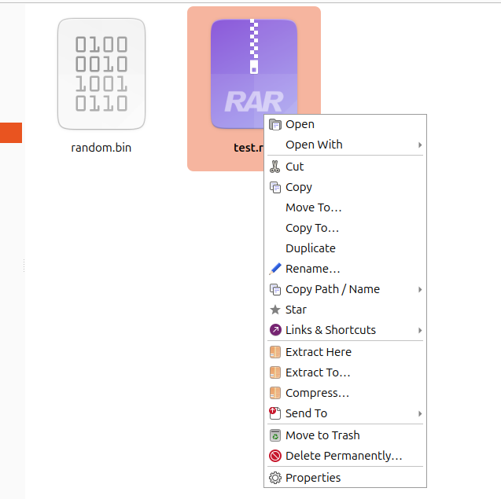

# Archives

[← Back to the README](../README.md)

Double-clicking an archive opens Kestrel's Extract dialog instead of another app (packages, disk images and apps such as `.deb`, `.iso` and `.apk` still open with the system's app). Kestrel doesn't contain its own compression code. It drives the command-line tools installed on your system, and offers the formats those tools support. Anything whose tool is missing is shown greyed out with the package to install. `./install.sh --install-recommended` installs the common ones (see [Dependencies](dependencies.md)).

## Extracting

Right-click an archive:

- **Extract Here** extracts next to the archive into a new folder named after it (`photos.tar.gz` → `photos/`). If everything in the archive is already inside a single folder, that folder is used instead, so you don't get `photos/photos/`. Name clashes get a number: `photos (2)`.
- **Extract To…** lets you choose:
  - the destination folder (created if needed);
  - whether to use a new folder named after the archive;
  - what to do with files that already exist: keep both (rename), replace or skip;
  - for rar, 7z and zip, **Keep damaged files**: files that fail their checksum are kept as far as they could be
    extracted, and listed afterwards, instead of the whole extraction failing;
  - whether to move the archive to the trash afterwards, and whether to open the extracted folder.

  These choices, except the destination, are remembered.

**Several archives at once.** Select more than one archive and right-click: **Extract All Here** and **Extract All To…** extract each of them the way Extract Here / Extract To… does on its own (its own folder, the same handling of existing files), one after another, as one job in the status bar: its ✕ stops them all. A split set selected whole (`x.part1.rar` … `x.part3.rar`) counts as one archive. At the end one summary says what was extracted and what wasn't (a password window you cancelled, a missing program, a damaged archive), with the details under **Show Details**, instead of a message per archive.

**Encrypted archives.** Kestrel checks every archive before extracting. If it's encrypted (including RAR and 7z archives whose file names are hidden) it looks for the password, and asks only when it has none that opens it. A wrong password asks again, and nothing half-extracted is left behind. In Extract All, the first password you type is tried on every encrypted archive after it; you're asked again only for one it doesn't open, and the new password is then the one tried on the rest. Trying a password is a quick test (listing the archive, or testing its smallest encrypted file), not an extraction.

**Remembered passwords.** The password window has a **Remember this password** box (off by default; only shown when a keyring is running). Ticked, the password is saved in your desktop's login keyring (GNOME Keyring on Ubuntu and Mint, KWallet on KDE, through the Secret Service), as "Kestrel Explorer: archive password for photos.7z" in Passwords and Keys (Seahorse). It's saved only when you ask, because any app running as you can read the login keyring. Kestrel then finds a password in this order: the one typed last in this job, the one saved for this archive (recognised by its size and the start of its contents, so renaming or moving it doesn't matter), then each of the other saved ones, and only if none opens the archive does it ask. **Preferences → Forget Saved Archive Passwords…** deletes them all (or delete single ones in Passwords and Keys). Without a keyring everything works the same, without saving.

**Looking inside: Open as Archive.** Right-click an archive → **Open as Archive** opens a window listing what's inside it, as a tree of its folders and files with their sizes, packed sizes and times (🔒 marks an encrypted file), with a filter box. Select files or folders and choose **Extract Here** (next to the archive) or **Extract To…**: each one is put right in that folder under its own name (`photos/2024/beach.jpg` → `beach.jpg`; a folder comes with everything inside it). A name that's taken gets a number; nothing is replaced. The items are extracted into a hidden folder first and moved into place only once all of them are complete, so a failure or ✕ leaves nothing half-made. **Extract All…** and **Test** are there too. It works for 7z, zip, rar, zpaq and tar archives (with any compression) and what 7-Zip opens (iso, deb, cab…), not for a single compressed file (`.gz`, `.xz`…), which holds one file anyway. An archive whose names are encrypted asks for its password before it can be listed (a saved one is found first); one with encrypted files asks when you extract one of them, once while the window is open.

**Testing: Test Archive.** Right-click an archive → **Test Archive** (or several → **Test Archives**) decompresses everything in it and checks each file against its checksum, without writing anything: 7-Zip, `unrar`, `unzip` and `zpaq` test their formats, and for tar and single compressed files the compressor checks its data and tar reads the archive through. It runs as a job in the status bar, finds or asks for passwords as extracting does, and ends with one message: OK, or which files are damaged, with the program's own words under **Show Details**.

**Split archives.** Right-clicking any part of a split set (`x.part3.rar`, `x.7z.003`, `x.zip.002`, old-style `x.r05`) extracts the whole set, starting from the first part. All parts must be in the same folder.

## Compressing

Select files and/or folders, right-click and choose **Compress…**. The dialog shows only the options the chosen format supports:

| Option | What it does |
|---|---|
| Archive name, Location | Where the archive is saved. Defaults to the selection's folder and name. |
| Format | See the table below. Formats whose tool isn't installed are greyed out; single-file formats need exactly one file selected. |
| Program | Which tool to use when there's a choice: pigz or gzip, pbzip2, lbzip2 or bzip2, plzip or lzip, 7-Zip or zip. |
| Compression level | The tool's own scale, e.g. 0–9 for 7z (Store … Ultra), 1–22 for zstd (20+ is "ultra"), 1–5 for zpaq. |
| Method | 7z: LZMA2, LZMA, PPMd, BZip2, Deflate or Copy. zip with 7-Zip: Deflate, Deflate64, BZip2, LZMA, PPMd or Copy. |
| CPU threads | Auto uses all cores. Shown for tools that support threads. |
| Encrypt with a password | 7z (AES-256), zip (AES-256 or the weaker but universally readable ZipCrypto), rar and zpaq. **Also encrypt file names** (7z, rar) hides even the list of files. |
| Split into volumes | Parts of a chosen size in MB or GB: `.7z.001`, `.zip.001`, `.part1.rar`, …. |
| Solid archive | 7z and rar: compress files together for a smaller archive, at the cost of slower single-file extraction. |
| Recovery record | rar: extra data (1–10%) that lets `rar` repair a damaged archive. |
| Extra options | Anything else, passed straight to the program, e.g. `-mfb=273` for 7z or `--long=27` for zstd. |
| Move the original files to the trash afterwards | Only after the archive was created successfully. |

The **Command** box at the bottom shows exactly what will run (with the password masked). Your choices are remembered per format, but the password never is. Afterwards, the right-click menu also offers **Compress to “name.ext”**, which uses your last format and options (without a password) in one click.

## Formats

| Format | Create with | Extract with | Password | Split | Notes |
|---|---|---|---|---|---|
| 7z | `7z` | `7z` | AES-256, optional hidden names | yes | Solid; choice of method |
| zip | `7z` or `zip` | `7z` (or `unzip`) | AES-256 or ZipCrypto (`zip`: ZipCrypto only) | with 7-Zip | Split zips are `.zip.001` parts, which 7-Zip joins |
| rar | `rar` (non-free) | `unrar` | yes, optional hidden names | yes | Solid; recovery record. Ubuntu's 7-Zip can't decompress RAR, so extracting needs `unrar` |
| zpaq | `zpaq` | `zpaq` | yes | no | Journaling, very high compression at levels 4–5 (and very slow) |
| tar | `tar` | `tar` | no | no | |
| tar.gz | `pigz` or `gzip` | same | no | no | pigz uses all cores |
| tar.bz2 | `pbzip2`, `lbzip2` or `bzip2` | same | no | no | |
| tar.xz | `xz` | `xz` | no | no | Multi-threaded |
| tar.zst | `zstd` | `zstd` | no | no | Very fast; levels up to 22 |
| tar.lz | `plzip` or `lzip` | same | no | no | |
| tar.lz4 | `lz4` | `lz4` | no | no | Fastest, lowest ratio |
| gz, bz2, xz, zst, lz, lz4 | as above | as above | no | no | One file only, no folder structure |
| iso, cab, deb, rpm, wim, cpio, msi, … | — | `7z` | — | — | Extract only |

Symbolic links are stored as links (zpaq is the exception; see below). File names in any language are stored correctly.

## Progress and cancelling

Archive jobs run in the background and show in the status bar with a progress bar, ✕ to cancel, and the elapsed time for anything over 5 seconds. Cancelling stops the tool immediately and removes the partial archive, or the half-extracted folder Kestrel made for it. Extracting straight into an existing folder may leave what was already written there, and files it overwrote aren't put back.

Not every tool can report real progress, so the bar shows what each one can:

- **7z, rar, unrar:** a real percentage for the whole job.
- **tar formats and single-file formats:** Kestrel feeds the data to the compressor itself and counts the bytes. Multi-threaded xz takes in its input faster than it compresses, so after the input is handed over the bar shows "xz is compressing the last data" with a clock.
- **zip:** the number of files done, so a single huge file shows no movement while it's compressed.
- **zpaq:** its percentage only counts files being *read*, which takes seconds. The real compression that follows prints nothing, so the bar switches to "compressing (zpaq reports no progress for this step)" with a clock. At levels 4–5 this can take several minutes per few hundred MB and about 500 MB of RAM per thread. zpaq extraction reports progress only occasionally, so it mostly shows the clock.

## Passwords and security

- **7-Zip, `rar` and `unrar`** receive the password privately, on their standard input.
- **`zip` and `unzip`** (used only when 7-Zip isn't installed, or when you pick `zip` as the tool) receive it in an environment variable (`ZIPOPT`, `UNZIP`), which only you and the administrator can read. `unzip` can't take a password that starts with `-`.
- **`zpaq`** only accepts a password on its command line. While the job runs, another user logged in to the same computer could see it in the process list. The Compress dialog says so when you pick zpaq.
- **ZipCrypto** is weak encryption; use AES-256 (the default) unless the archive must open in very old tools.
- **Links that point outside the extraction folder** (for example to `/etc/...`) aren't recreated as-is: 7-Zip re-roots them inside the folder and `unrar` skips them. This protects you from malicious archives. Kestrel relies on the tools here (it doesn't extract archives itself), so the tests extract crafted archives (`../` names, absolute paths, a symlink and then a file written through it) with tar, 7-Zip and unrar, and check that nothing lands outside the destination (tested with tar 1.35, 7-Zip 23.01 and 26.00, unrar 7.00 and 7.20).

## Known limitations

- **zpaq can't store symbolic links;** any in the selection are skipped. The dialog says so.
- **Creating .rar needs `rar`,** which is non-free (a trial of WinRAR's command-line tool) and not installed by default.
- **zip volumes** made with 7-Zip are plain `.zip.001` parts, not the "spanned" zip format some Windows tools expect.
- **Tools only report progress as described above.** A single large file in zip, or zpaq's compression phase, shows the clock rather than a percentage.
