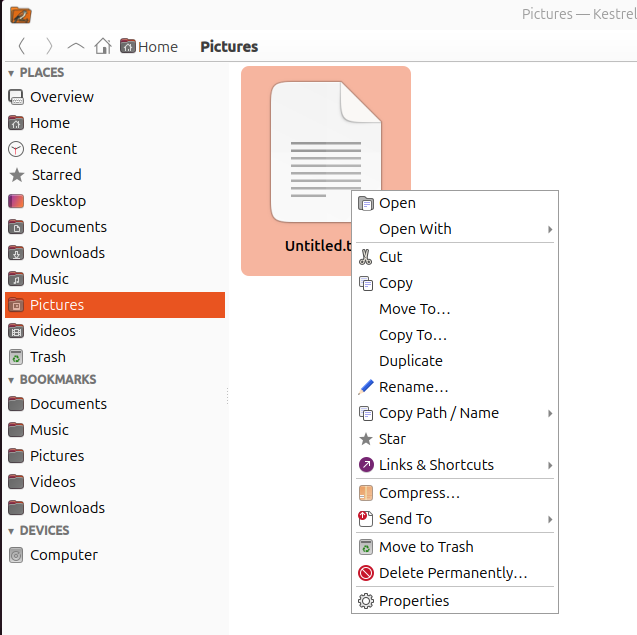

# Features

[← Back to the README](../README.md)

**File management**
- Tabs, back/forward history, a clickable path bar (Ctrl+L to type a path), and a sidebar.
- Follows the desktop's theme: light or dark, accent colour, fonts and icons, including switching while Kestrel is open. On GTK desktops the theme's own look needs `qt6-gtk-platformtheme` (see [Dependencies](dependencies.md)); the dark style is followed without it too.
- **Other apps' Open and Save dialogs** (a browser's "Save image as", Flatpak and Snap apps, and GTK 4 and Qt apps that use the desktop portal) open as a Kestrel window, with the file name, the file type and Save/Open at the bottom, once you've run `./install.sh --default` (see [Build / install](install.md#build--install)).
  - **Free names, as browsers give repeated downloads:** when a Save window's folder already has a file of the suggested name, the name becomes the next free one (`photo.jpg` → `photo (1).jpg`, then `(2)`…), in each folder you go to; where the original is free it comes back. A name you type or a file you pick is yours and stays as it is (Kestrel asks before saving over a file). Saving several files at once gives each one a free name the same way.
  - **Save locations:** Preferences → Windows can have a Save window start on an Overview of its own, which shows first the folders you keep for saving (Downloads, a project folder…). They're only for Save windows: adding one doesn't star or bookmark it. Add them with **Add Folder…** on that page (or in Preferences), and right-click one to move it earlier or later or to remove it. An app saving over an existing file still opens in its folder, and Open windows start where the app asks.
- The sidebar shows standard places, your GTK bookmarks (shared with GNOME Files), mounted drives and connected phones, with an unmount option. Drives aren't polled: Kestrel hears from the kernel when one is mounted or unmounted, reads a disk's size from the system without asking the drive, and asks for free space only when you open a folder or a job ends.
- **Mounts** in the sidebar lists the mounts GNOME Files shows that aren't drives of their own: ZFS datasets, FUSE mounts (sshfs, rclone, gocryptfs…) and other mounts in your home folder, and network shares (SMB, SFTP, FTP…) connected through the desktop. Each says what it is when you hover over it, and its right-click menu can unmount it. Recently used servers that aren't connected show greyed: click one to connect, or right-click → **Remove from Recent Servers**.
- Drag sidebar entries to reorder them within a section, drag a section header to move the whole section, and click a header to collapse it.
- Right-click a bookmark → **Edit Bookmark…** to change its name and location (with a folder picker), or remove it or move it up and down.
- Grid and list views, sorting, hidden files (Ctrl+H).
- **A sort for each folder.** Changing the sort (the column headers or the Sort menu) changes it for that folder
  only, which keeps it. Folders that were never sorted use the default: **Sort → Set as Default** makes the current
  sort the default. **Sort → Apply to Subfolders** gives every folder below this one the same sort.
- **Group by Period / Group by Day** (Sort menu). The items go under date headers, newest first: by period (Today,
  Yesterday, Earlier this week, Last week, Earlier this month, Last month, Earlier this year, then each year) or one
  per day. Inside each group they keep the chosen sort, so you can group by date and sort by name, size or type. Click
  a header (or press Enter on it) to collapse its group. A long group can be collapsed without scrolling back up to
  its header: click the **Collapse …** line at its end, press **Ctrl+Left** on any of its items (Ctrl+Right expands
  it), or right-click an item → **Collapse This Group**; the view stays on its header. **Collapse All Groups** and
  **Expand All Groups** are in the Sort menu and on empty space's right-click menu. **Date to Group By** picks the date: modified, created, or
  taken (a photo's EXIF, a PNG's Creation Time, an MP4 / MOV video's header; read in the background, falling back to
  the date created). Also in search results, Starred, Recent and Trash; kept per folder, like the sort.
- While a search runs, a thin progress bar shows under the search bar (and "Searching…" in the view until something is found); a search that finds nothing says **Nothing found** in the view itself (with the reason when something went wrong, such as a regular expression that doesn't parse), never in a window.
- Search the current folder by typing to filter, or search subfolders recursively. Wildcards are supported.
- **Search filters:** the search bar's **Filters** button adds a row to find by type (images, videos, audio, documents, archives, folders), size (larger or smaller than) and date (today, this week, this month, this year, or between two days; modified or created), with or without a name, in this folder or with its subfolders. They're kept for the session, in every tab and window; **Clear** empties them.
- Cut, copy and paste work with GNOME Files' clipboard. Paste as link and pasting image data are supported.
- Drag and drop:
  - Ctrl copies, Shift moves, Ctrl+Shift creates a link, and Alt asks what to do.
  - With no key held, a drop moves files on the same drive and copies them to another drive.
  - The folder under the pointer is highlighted, so you can see where the files will go.
- File operations run on background threads, so the window stays responsive even with tens of thousands of files. Copy, move, duplicate, move to trash, permanent delete, restore, empty trash, compress and extract show their status and a progress bar in the status bar at the bottom of the window, with ✕ to cancel. When several run at once, the bar shows the oldest with "+N more" (hover to see them all). Operations running in your other Kestrel windows are counted too ("+N in other windows"), or shown when this window has none; ✕ on one of those asks its window to cancel it, and 🛡 marks admin-session jobs. Closing a window while operations are running asks whether to stop them or keep going.
- If a name already exists when copying or moving, you can replace, merge, skip or keep both.
- Trash, permanent delete, and restoring or emptying the trash. The Trash shows everything you've deleted on every drive in one list: your home trash plus the trash folder each drive keeps for files deleted on it (`.Trash-<uid>`, the same as GNOME Files). The Location column shows where each item came from, and Restore, Delete Permanently and Empty Trash work across all of them.
- **Shred with BleachBit:** with [BleachBit](https://www.bleachbit.org) installed, right-click files or folders → **Shred with BleachBit…** overwrites them and then deletes them, so they can't be recovered; **Empty Trash with BleachBit…** (in the Trash and on the sidebar's Trash) does the same to everything in the trash, on every drive. Both ask first, run in the status bar with ✕ to stop, and list anything BleachBit couldn't shred. On SSDs and some file systems, overwriting can't guarantee that every old copy of the data is gone.
- Nothing is replaced until its replacement is complete, and no file appears half-written. Each file a copy or move writes, decompressing a single file (`.gz`, `.xz`, …), compressing over an older archive, checksum files, shortcuts, pasted images and Kestrel's own settings files are written under a hidden name (`.kes-….part`) beside their destination and renamed into place the moment they're complete. A full disk, a cancel or a crash leaves the old version as it was, never a half-written one. (One exception, on tapes: see below.)
- Copying a folder to a new place (from a camera's SD card, say) makes the folder under its own name straight away, and each file shows up in it as soon as it's copied, not when the whole copy is done. Cancelling keeps the files copied so far (Ctrl+Z puts them in the trash). Replacing an existing folder is different: the new one is built beside it and swapped in only when complete, so cancelling leaves the old one as it was. Merges, deletes and moves between drives can't be all-or-nothing either, so each file in them is still handled whole and nothing is lost; extracting directly into an existing folder may leave partial results after a failure or cancel, and files it overwrote are not rolled back.
- A copy, move or extracted file going to a name that was free never replaces something another program saves there in the meantime: that file is kept, and Kestrel says so. Only **Replace** replaces.
- Deleting handles read-only folders you own (common in extracted Windows archives): they're made writable and deleted.
- Copies and deletes never follow a symbolic link inside the folders they work through, so a folder swapped for a link while they run can't send them anywhere else. A delete also stops at another drive mounted inside the folder, instead of emptying it.
- Links and shortcuts:
  - Symbolic links (absolute or relative) and hard links.
  - Link to the Desktop.
  - `.desktop` shortcuts, marked as trusted so they can be launched.
- Rename (F2). Batch rename works with templates (`[Name] ###`, `[Date]`) or find and replace with regex.
- Duplicate, Move To…, Copy To…, and Compress / Extract (see [Archives](archives.md)).
- **Undo (Ctrl+Z)** for moves, renames (also batch), Move to Trash, and anything created by copy, paste, duplicate, new folder/file or links (undoing those moves them to the trash). The Edit menu shows what will be undone. Permanent deletes, merges into existing folders, archives and admin-session operations can't be undone. Each Kestrel undoes only what was done in it (its own windows); turn on Preferences → *Share undo between all Kestrel windows* to have Ctrl+Z in any window undo the newest action from any Kestrel. The shared history is kept by the tower (see below) and is cleared when the last Kestrel closes.
- **Starred and Recent** in the sidebar. Right-click anything → **Star** (starred items show a ★). Recent lists the desktop's recently used files; files you open from Kestrel are added unless "File History" is off in GNOME's Privacy settings.
- **Pinned items.** Right-click → **Pin** marks an item in its own folder (a red pin); it isn't added to Starred. **Sort → Pinned & Starred First** puts pinned and starred items at the top of their folder, each group still in the chosen order.
- **Several Kestrels stay in sync.** Each folder opened from another app may start its own Kestrel, so a crash only closes that one. A small background helper, the tower (`kes --atc`, started automatically and gone about 10 seconds after the last Kestrel closes), passes changes between them: saved Preferences, stars, pins, folder sorts, folder colours, covers and preview switches, bookmarks, the sidebar's layout, and cleared preview caches show up in every open window straight away, and every window's status bar also shows the operations running in the others. A newly opened window sees operations already running, and a Kestrel that closes or crashes drops out of the list. With Preferences → *Open folders from other apps as tabs in an open Kestrel window* (off by default), a folder opened from another app, from the terminal (`kes ~/Pictures`) or with "Show in folder" becomes a tab in the Kestrel window you used last, instead of a new window. Starting Kestrel without a folder (e.g. from the app grid) still opens a new window, and a Kestrel started from a conda environment you activated always opens its own. Admin sessions are not shared: each window keeps its own.
- **Search file contents**: the search bar's *File contents* option searches inside files, in the current folder (and its subfolders with *Include subfolders*). **Automatic** uses the desktop's search index (`localsearch`) where it covers the folder (instant), and otherwise reads the files themselves with `ripgrep` (much faster) or `grep`, so external drives, network shares and folders the index skips are searched too; when the index finds nothing (it isn't running, or hasn't got to the folder yet), the files are read after all. Or choose **Search index** or **Read the files** yourself. Reading the files also offers **Regular expression** and **Match case**, skips binary files, and shows the matching line and its number in a *Match* column (the first few in its tooltip); ✕ stops it. Opening a result starts your text editor at that line where the editor allows it (gedit, Geany, VS Code, Kate, Sublime Text, Zed…; GNOME Text Editor has no way to be told one, so it opens the file). Files on a tape or floppy are never read for this.
- **Thumbnails for other files** (PDFs, fonts, audio covers, comics…) come from the system thumbnailers GNOME Files uses. Images and videos keep Kestrel's own fast thumbnailing; a system thumbnailer is only a fallback when an image can't be decoded.
- **Extras GNOME Files offers through extensions:** *Open in Visual Studio Code* (and VSCodium, Cursor, Zed, Sublime Text) and *Open With* for folders; your **Nautilus scripts** (`~/.local/share/nautilus/scripts`) under *Scripts*, with the same `NAUTILUS_SCRIPT_*` variables; **Send To** → Email or Bluetooth; and **Network Sharing…** for folders (Samba usershares, needs the `samba` package).
- Open With: shows recommended apps and lets you set the default app. You can also open a terminal in the current folder or set an image as wallpaper.
- **UWP wallpapers** (when [UWP](https://github.com/RegulusArms/UWP) is installed):
  - **Set as Wallpaper (UWP)** on an image or video adds it to UWP's library and shows it on every monitor as a new UWP profile named after the file. It starts UWP if needed and opens its editor. Without UWP, "Set as Wallpaper" sets the GNOME background instead.
  - **Add to Selected UWP Monitor** appears while UWP's editor window is open. It adds the file to UWP's library and puts it on the monitors selected in the editor (or adds it to that monitor's slideshow). Press OK in UWP to keep it, just as when you pick from UWP's own library.
- Properties window:
  - **General:** size (recursive for folders), dates, inode, the free space on the drive, and the default app.
  - **Permissions:** an editable rwx grid plus setuid, setgid and sticky bits.
  - **Image:** image details and a Set as Wallpaper button.
  - **Metadata:** every tag exiftool can read, with a filter. With `exiftool` installed you can also edit the file's metadata, and changes are written straight to the file:
    - **Edit:** double-click a tag to change its value. List tags such as keywords are edited one item per line.
    - **Add Tag…:** a searchable list of the tags this file type supports, with columns for the tag, what it's for, and what it accepts (text, numbers only, date/time, a fixed choice, or true/false). The allowed values are shown for choice tags.
    - **Remove:** delete one or more selected tags.
    - **Clear All Metadata…:** strip everything, optionally keeping the orientation and colour profile so the image looks the same.
    - Greyed-out rows (file system info and values exiftool calculates) are read-only.
    - The tag descriptions and "Accepts" types were written with the help of an AI tool while Kestrel was being made, and may not be completely accurate. They ship as fixed text: Kestrel itself runs no AI. Descriptions outside the common tags are built from exiftool's tag names and categories.
  - **Checksums:** MD5, SHA1 and SHA256, with a field to check against a known checksum, or **Browse…** for a checksum file that lists the file (see [Checksum files](features.md#checksum-files)).

**Jobs: one queue, and the Jobs window**
- Jobs that read or write drives (copy, move, delete, extract, compress, checksums, shredding) wait for their turn on the drives they use, across every Kestrel window and process, so two jobs never fight over one drive. By drive (the default): jobs on different drives run side by side, jobs on the same drive one after the other, in order. Or one at a time. A rename within a drive doesn't wait.
- Click the job progress in the status bar (or ☰ → **Jobs…**, Ctrl+Shift+J) for the **Jobs window**: every job of every Kestrel window, running, waiting and finished, with progress and time left. Select one for its steps and its log (the archive tools' live output, passwords masked), with Copy and Save Log…. Pause, Resume, Stop (Delete), Start Now, move a waiting job up or down; Pause All / Resume All; start new jobs paused; choose by drive or one at a time.
- A paused copy stops within a few megabytes (its part file kept aside); a paused extraction or compression pauses its program. Administrator jobs can't be paused.
- Preferences → **Show developer tools** adds ☰ → **Tower…**: the tower's status, the Kestrels checked in, every message it passes on, the queue and the drives in use, and the shared undo list (also `kes --tower-monitor`). Its **Windows** tab shows each of that Kestrel's windows as Qt sees it (size, the minimum and maximum it asks for, state, screen, border) and its recent changes, to copy or save: for a window that misbehaves, compare it with a new one (Ctrl+N).

**Tapes (LTFS) and floppy disks**
- Recognised automatically (a tape by its LTFS mount, a floppy as a removable disk of a few MB), with their own icons in the sidebar and on the Overview, where a tape shows its volume name and LTFS's details.
- Kestrel never waits for them in the window: their size is read in the background, and opening a folder or a checksum file on one doesn't freeze anything, even while another program is using the drive.
- Thumbnails, folder previews, image details, GIF/WebM playback and dates taken aren't read from them (each would make a tape wind or a floppy read for a long time). Right-click the drive → **Show Previews on This Drive** to allow them.
- One job at a time per drive (the job queue above): a second copy waits for its turn. Files are read off a tape in the order they lie on it, with "Positioning the tape" while it winds.
- After a copy to a tape its index is written (also **Write Tape Index Now** on the drive's menu); copying more than 1,000 small files to a tape asks first, since an archive of them is much faster. Unmounting runs in the background, and asks first while a job still uses the drive.
- **No shoe-shining:** copies onto a tape go through a buffer in memory, so the drive keeps streaming instead of stopping and rewinding whenever the source slows down (a seek, many small files, the next file being opened). The buffer is 16 GB where the system can spare it, and otherwise what it safely can: half the memory available at most, never leaving less than 10% of the total free (both set in Preferences → Files → Tapes, which shows the size it would get now, and says when 16 GB is more than the system can spare; 0 lets it use as much as is safe), gives memory back when other programs need it, and streams files far larger than itself (1 TB tarballs). Writing starts once the buffer is full; when the source can keep the drive at its lowest streaming speed or above (set the drive's generation in Preferences), the tape writes at the source's pace, otherwise it waits for the buffer to fill and writes in full-speed runs. The status bar and the Jobs window show "Filling the buffer", how full it is and both speeds; the job's log says afterwards how fast it went and how often the tape had to wait, and says so when the source is too slow for the tape to stream.
- A new file copied onto a tape is written under its own name straight away, without the hidden part file used elsewhere: on a tape it would protect nothing, since LTFS never gives back the space a failed write used, whatever the file is called. A file of that name that's already there is never replaced, and a cancel or a failed write deletes the half-written file (a crash or power cut in the middle of a file can leave it). Replacing a file on a tape still keeps the old one until the new one is complete, and floppies work like other drives.
- Before writing a file to a tape, Kestrel checks it fits (a write that runs out of tape wastes what it wrote: LTFS never reuses it), and nothing Kestrel shows while it writes (Properties, the info panel, previews) reads files from the tape. Nor does Kestrel ask the drive anything then (its size, its cartridge's health): each question interrupts its writing. Otherwise it asks its size every 30 seconds and its health every 10 minutes. LTFS writes a tape's index every 5 minutes by default, stopping the drive each time: the tape's Overview card and the copy's log say so when that's how it's mounted, with the option to use (`-o sync_type=unmount`).

**Archives** (details in [Archives](archives.md))
- **Extract Here** and **Extract To…** for 7z, zip, rar (including split `.part1.rar` sets), zpaq, tar with any compression, single `.gz`/`.xz`/`.zst`/… files, and iso, cab, deb, rpm and more.
- **Open as Archive**: a window listing what's inside an archive, to extract single files or folders from it (7z, zip, rar, zpaq, tar and what 7-Zip opens).
- **Test Archive(s)**: check every file in one or several archives against its checksum without extracting, with one message at the end.
- **Extract All Here** and **Extract All To…** for several archives at once: one job, one ✕, one summary at the end; a split set counts as one archive.
- **Encrypted archives**, including RAR and 7z with hidden file names: Kestrel asks for the password, and asks again if it's wrong. In Extract All the first password typed is tried on the rest, and you're asked again only when it doesn't open one.
- **Remember this password** (opt-in) saves an archive's password in your login keyring (GNOME Keyring, KWallet); a saved password is found again even after the archive is renamed or moved. Preferences can forget them all.
- **Compress…** on any files or folders: 7z, zip, rar, zpaq, tar, tar.gz/bz2/xz/zst/lz/lz4 or a single compressed file, using pigz, gzip, zpaq, zstd, xz, bzip2, lzip, 7-Zip, rar and the other tools you have installed.
- Every option the format supports: program, level, method, CPU threads, password (AES-256), encrypted file names, split volumes, solid archives, rar recovery records, and extra options for the program, with a live preview of the exact command.
- **Compress to “name.ext”** repeats your last settings in one click.
- Progress, elapsed time and Cancel in the status bar; cancelling removes partial output (extracting straight into an existing folder may leave what was already written).

**Admin session** (details in [Admin session](admin.md))
- When something fails because you don't have permission (copying into `/opt`, deleting files owned by root, renaming in a system folder…), Kestrel offers **Retry as Administrator**.
- You enter your password once. After that, a 🛡 **Admin** indicator shows in the status bar, and further operations that need admin rights run without asking again, until you end the session or it's unused for 15 minutes.
- It covers simple, everyday operations only. Batch renames, extracting archives into system folders and other work where one mistake as root could break the system are left to the terminal and the package manager, on purpose ([why](admin.md#what-it-doesnt-do-on-purpose)).
- Kestrel itself never runs as root.

**Overview (default homepage)**
- Like the old GNOME Files "Other Locations" page:
  - **Drives:** every drive with a usage bar (amber at 75%, red at 90%) and eject/unmount buttons. Unmounted drives can be mounted with a click, and encrypted drives ask for their passphrase. A ZFS pool appears as one card with pool-level numbers.
  - **Phones & Cameras:** connected phones and cameras (see below), or what to do on a phone to connect it.
  - **Network:** connected shares, plus a "Connect to Server" box for `smb://`, `sftp://`, `nfs://`, `ftp://` and similar addresses. Recent servers are remembered.
  - **Bookmarks:** your bookmarks as cards with folder previews. Right-click a card to edit or remove it.
- Preferences → Homepage can be the Overview, your home folder, or any folder or network address. The homepage opens at launch and with the Home button (Alt+Home).

**Phones and cameras**
- iPhones, Android phones and cameras (PTP) appear under **Phones & Cameras** on the Overview page and under Devices in the sidebar, through the desktop's own phone support (gvfs). Click one to connect it; Eject disconnects it. An iPhone has two entries: its photos and videos, and the files its apps share.
- If a phone doesn't show up or won't connect, Kestrel says what to do on it: unlock it and tap "Trust" (iPhone), choose "File transfer" in its USB notification (Android), or switch the camera to photo transfer (PTP).
- Thumbnails come from the phone's own small previews where it has them (an iPhone's photos, Android phones). Otherwise files are read one at a time, images up to 30 MB. Folders on a phone get no preview mosaic, since that would download every file.
- Videos from an iPhone's photos are copied to your computer before they play, because the phone sends the whole file every time it's opened. The status bar shows "Loading from device: … — will launch once ready" with a pulsing bar, and the video opens when it's there. Copies are kept in `~/.cache/kestrel-explorer/device-files`, reused when you open the video again, and deleted after a day.

**Images and galleries**
- Folder icons show a 1–4 image mosaic. If a folder has no images of its own, the mosaic is taken from its subfolders.
- A folder with only videos uses a still from the middle of each video, marked with a ▶ badge.
- Right-click a folder (or empty space in one) → **Previews**:
  - **Generate Previews Recursively** pre-builds every thumbnail and folder preview below it.
  - **Generate Folder Previews** builds only the folder previews, for the folder and the folders directly in it, without making a thumbnail for every file. **Generate Folder Previews Recursively** does the same for every folder below it.
  - **Regenerate Previews**, **Regenerate Folder Previews** and their **Recursively** forms make them again even where they were made before, replacing the cached ones (for previews that look wrong or out of date). Without "Recursively": the folder's own files and its preview, and the previews of the folders directly in it.
  - Each one is a job of its own: it waits for its turn on the drive, shows in the status bar and the Jobs window, and can be paused or stopped (✕). Several can be started at once.
- The **Folder previews** checkbox in the toolbar (Ctrl+Shift+P) turns the mosaics off for speed in large or slow folders. Image file thumbnails stay on.
- If a folder contains an image named `cover`, `folder`, `front` or `poster` (any extension, also hidden as `.cover` or `.folder`), that image is used as the cover. You can also right-click an image and choose "Use as Folder Cover", and "Reset Folder Cover" to undo it.
- Right-click a folder → **Regenerate Preview** rebuilds its mosaic. The ☰ menu has **Clear Folder Preview Cache** and **Delete All Thumbnails…** to free disk space or start fresh.
- Right-click one or more folders → **Folder Colour** to give their icons one of 10 colours (or back to Default, which follows the desktop's accent colour unless you pick a fixed one in Preferences). Only the folder behind the image mosaic changes colour; the previews stay. **Show Image Previews** turns the mosaic off for just those folders (they keep their colour). Both settings are also on the folder's Properties → General tab.
- Thumbnails are generated in background threads and support JPEG, PNG, GIF, WebP, TIFF, SVG and video (with `ffmpeg`). AVIF, HEIC, JPEG XL, PSD and camera RAW also work when `kimageformat6-plugins` is installed (see [Dependencies](dependencies.md)).
- Thumbnails are shared with GNOME Files through the freedesktop cache (`~/.cache/thumbnails`).
- Zoom with Ctrl+scroll or the slider, from 48 to 320 px in the grid (16 to 128 px in the list).
- **Animated GIFs and WebM videos can play right in the file view** (Preferences → *Play animated GIFs* / *Play WebM videos in the file view*, both off by default). WebM files play as silent looping previews of their first 15 seconds, made once with `ffmpeg` and cached in `~/.cache/kestrel-explorer/animated`. Only items on screen play.
- Built-in viewer: arrow keys or the scroll wheel to move between images, zoom and pan, fullscreen (F), slideshow (S), rotate (R/L) and flip (H), an info overlay (I), copy the image (Ctrl+C), trash (Delete), and animated GIF/WebP.
- Images and videos open in your system's default app unless you choose otherwise. In Preferences you can pick **Open images with** (system default, Kestrel's built-in viewer, or any installed image app) and **Open videos with** (system default or any installed video app). "View Image" in the right-click menu always uses the built-in viewer.
- The info panel (F3) shows EXIF details: camera, lens, exposure and GPS.
- It also shows the prompts and settings that Stable Diffusion, ComfyUI and other image generators save in PNG, WebP and JPEG files. Kestrel only reads that text from the file.

Press F1 in the app for all keyboard shortcuts.

## Preferences

☰ → **Preferences…** shows every setting Kestrel keeps in one window, in tabs, including the ones you'd otherwise change somewhere in the windows (each says where else it's set, such as "Also: ☰ → View → Show Hidden Files (Ctrl+H)"):

- **General:** homepage, single-click, which apps open images and videos, opening the image viewer full screen, sharing undo between windows, developer tools.
- **Views:** grid or list, icon sizes, hidden files, the sidebar and info panel, the default sort and grouping for folders without their own, Pinned & Starred First, folder previews (how many images, which ones, the colour), and the search bar's options.
- **Sidebar:** the order of its sections and which are collapsed.
- **Images & Videos:** slideshow speed, playing GIFs and WebM videos, the preview size limit, and the tapes and floppies you allowed previews on.
- **Files:** checksum file defaults, how the job queue runs, and the tape buffer.
- **Archives:** the default format and each format's options for Compress…, Extract To…'s choices, and forgetting saved archive passwords.
- **Windows:** opening folders from other apps as tabs, the file chooser's own view (it follows the main windows' until you set it), where a Save window starts, and its save locations.
- **Menus:** the right-click menus (below).

A change applies at once to every open window, and to the other Kestrels; a change made in a window (Ctrl+H, the zoom slider…) shows in an open Preferences window as it happens. The search box at the top filters every tab's settings. **Reset This Tab** and **Reset All** go back to the defaults, after asking.

**Your own right-click menus.** Preferences → **Menus** sets up the right-click menu separately for a folder, a file, an archive, several items, and the empty space in a folder. Untick an entry to hide it; drag entries (or use Move Up / Move Down) to reorder them and to move them into or out of a submenu, such as Links & Shortcuts; add separators and submenus of your own. An entry only appears when it applies (Extract for archives, BleachBit's entries when it's installed…), wherever you put it, and entries added in later versions show up in their default place. **Reset to Default** puts a menu back as it was.

## Checksum files

Double-clicking a checksum file opens **Verify Checksums** instead of a text editor. It checks every file the checksum file lists, one after another, with a progress bar: each row shows ✔ OK, ✘ Doesn't match (hover for the expected and actual hash), ✘ Missing, or why the file couldn't be read, and the summary says how many passed. **Stop** stops part-way and **Verify Again** starts over. A file that only looks like a checksum file (a `.md5` with no checksums in it) opens as usual.

- Files: `.sfv`, `.md5`, `.sha1`, `.sha224`, `.sha256`, `.sha384`, `.sha512`, `.b2` (and `.md5sum`, `.sha256sum`, …), `MD5SUMS`, `SHA256SUMS`, `B2SUMS` and the like, and `CHECKSUM` files such as Fedora's.
- Formats: `md5sum`/`sha256sum` output (`hash  name`, `hash *name`, and their escaped names), BSD tags (`SHA256 (name) = hash`, as `--tag` and Fedora write them, inside a PGP-signed file too), SFV (`name CRC32`, `;` comments), and a file holding only a hash, which is for the file of the same name without the extension (`disk.iso.sha256` → `disk.iso`).
- Algorithms: CRC32, MD5, SHA1, SHA224, SHA256, SHA384, SHA512 and BLAKE2b, from the BSD tag, else from the file's name, else from the hash's length.
- Names are relative to the checksum file's folder.

In **Properties → Checksums**, **Browse…** checks one file against a checksum file: it finds the file's line (by path, else by name) and says whether it matches.

**Create Checksum File…** (right-click one or more files or folders) makes checksum files. Pick the algorithms (CRC32, MD5, SHA1, SHA256, SHA512, BLAKE2b) and whether to write one file per algorithm, as `md5sum`, `sha256sum` and the others write them (CRC32 as an `.sfv`), or one `name-CHECKSUM` file with every algorithm as BSD tags. Then pick the name and the folder to save in (by default the selection's name and folder). The files inside folders are included, with names relative to the checksum file, so `sha256sum -c` (or `cksum -c` for a CHECKSUM file) and Kestrel's own Verify Checksums can check them later. Each file is read once for all the algorithms, with progress in the status bar. A file that can't be read is left out and named afterwards. Kestrel remembers the algorithms and the layout you chose last.
